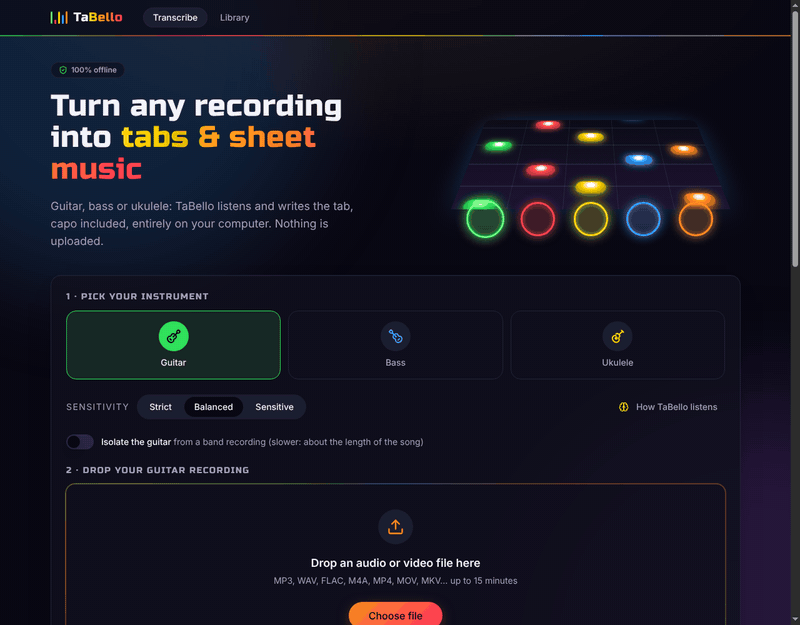
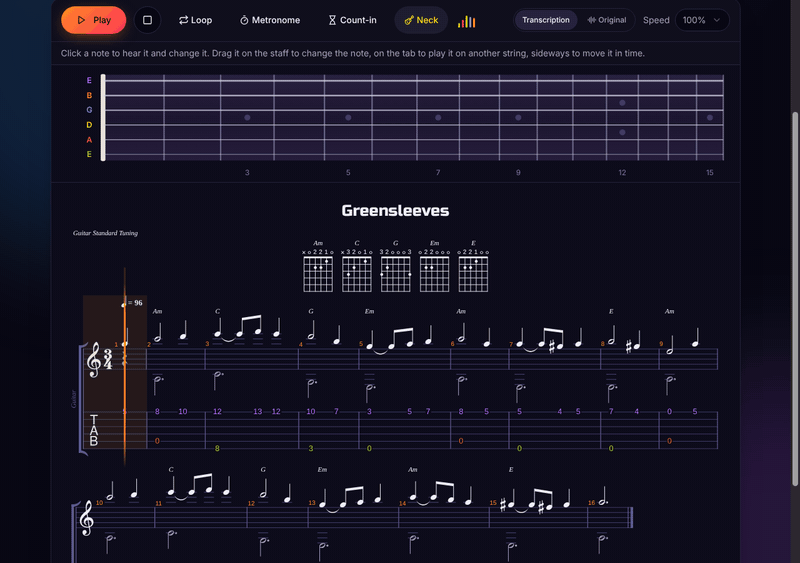
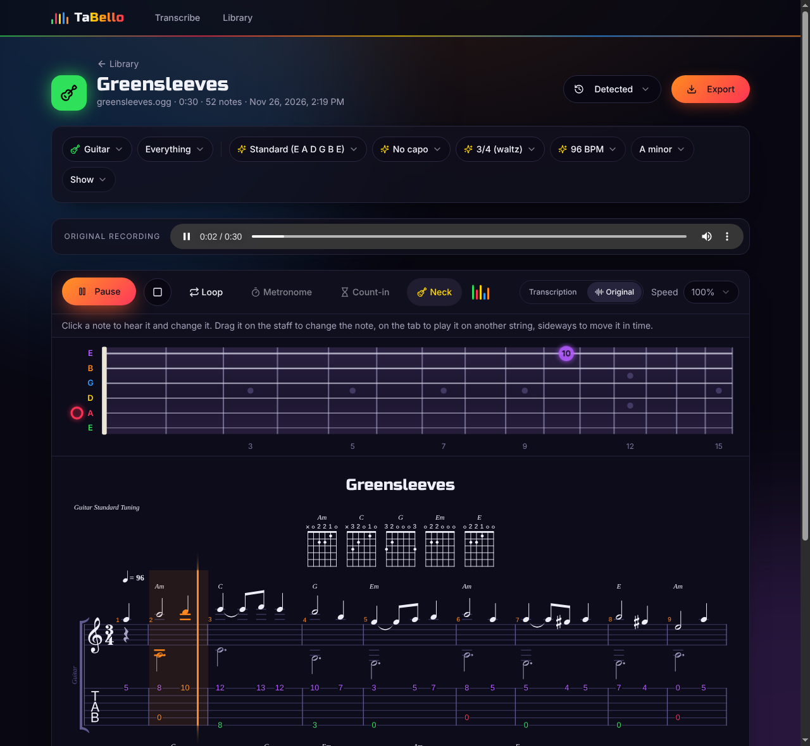

# TaBello

**Turn any recording into guitar, bass or ukulele tabs — entirely on your computer.**

Give TaBello an audio or video file — a lesson, a live clip, a demo you recorded — and it writes
notation and tablature you can play back, slow down, fix and export. Free and open source; no account,
no upload.

> **Public beta** (0.1.0-beta): it works, and it still has rough edges. Tell us what goes wrong with
> *Report a problem* at the bottom of the app.



## What it does

- 🎸 **Tab and notation** for guitar, bass and ukulele, with tempo, key, time signature, tuning, capo and
  chord names detected for you.
- 🎛️ **Isolate an instrument from a band** recording before transcribing it.
- ✋ **Watches the hand in videos**, so notes are written where they are actually played.
- 🎧 **Practice**: play it back or along the original recording, see each note on the neck, loop a
  passage, slow it down, add a count-in, transpose with a capo.
- ✏️ **Fix notes by taking them**: drag them on the staff or the tab, change their value, move them
  elsewhere on the neck, and save versions of your edits.
- 📤 **Export** to Guitar Pro, MIDI or alphaTex.

| Edit a note: drag it, the lens shows where it lands | Everything detected, the neck lit as it plays |
| --- | --- |
|  |  |

## Download

Get the installer from the [Releases page](https://github.com/JackF007/taBello/releases) (newest
release, under *Assets*):

| Computer | File | Install |
| --- | --- | --- |
| **Windows** 10/11 | `TaBello-Setup-<version>.exe` | Double-click it. |
| **Linux** (Ubuntu, Debian, Mint…) | `TaBello-<version>-linux-amd64.deb` | Double-click it, choose *Install*. |
| **Linux** (other) | `TaBello-<version>-linux-x86_64.AppImage` | Make it executable, then double-click it. |

Windows may show "Windows protected your PC" the first time: click *More info → Run anyway*. A **Mac**
build is coming; meanwhile, run it [from source](#contributing).

## How to use it

1. **Pick your instrument** — turn on **Isolate** for a full band recording.
2. **Drop a recording** (MP3, WAV, FLAC, M4A, MP4, MOV, MKV… up to 15 minutes), or **Try** a sample.
3. **Check it and fix it.** The chips at the top show what was detected (✦): click one only if a guess
   is wrong. Press **Play**, or **Original** to hear the recording with the score following it. Click a
   note to hear it, drag it to fix it, then **Save version** (Ctrl+S). **Export** when you are done.

Keys: Space play/pause · ↑/↓ a semitone · Delete · Ctrl+Z undo · Ctrl+S save a version.

## Good to know

- **Solo recordings work best.** For a band, turn on *Isolate*; clean, close recordings beat noisy ones.
- **Tempo off by half or double?** Choose *Half* or *Double* in the tempo chip.
- **Unusual tunings** (DADGAD, open G) and **6/8** are not guessed: pick them in their chips.
- **Techniques** (bends, slides, hammer-ons…) are experimental: *Show* turns them off.
- Rhythms are written on a 16th-note grid; very fast runs and dense chords can lose notes, and two
  guitars playing chords together are heard as one.
- **Private**: everything runs on your computer. TaBello goes online only to download its separation
  model once (about 100 MB) and to check GitHub for new versions (you can turn that off).

## Under the hood

FFmpeg reads the recording → [Demucs](https://github.com/facebookresearch/demucs) isolates the
instrument (optional) → Spotify's [Basic Pitch](https://github.com/spotify/basic-pitch-ts) detects
the notes → TaBello's music engine finds tempo, key, meter, tuning, capo, chords and fingering, guided
by [MediaPipe](https://github.com/google-ai-edge/mediapipe) watching the hand in videos →
[alphaTab](https://alphatab.net/) draws and plays the score. Built with Electron, React and TypeScript.

## Contributing

Bug reports, transcription examples and pull requests are welcome — see
[CONTRIBUTING.md](CONTRIBUTING.md) and the [code of conduct](CODE_OF_CONDUCT.md). To run it from source
you need [Node.js](https://nodejs.org/) 22.23.4+ (or 24.22.1+) and Git:

```sh
git clone https://github.com/JackF007/taBello.git
cd taBello
npm install
npm run dev
```

Security problems: please report them privately ([SECURITY.md](SECURITY.md)). What changed in each
version: [CHANGELOG.md](CHANGELOG.md).

## License

Copyright © 2026 JackF007. TaBello is free software under the
[GNU General Public License v3.0 or later](LICENSE). It builds on many open-source projects, listed with
their licenses in [THIRD_PARTY_NOTICES.md](THIRD_PARTY_NOTICES.md).
